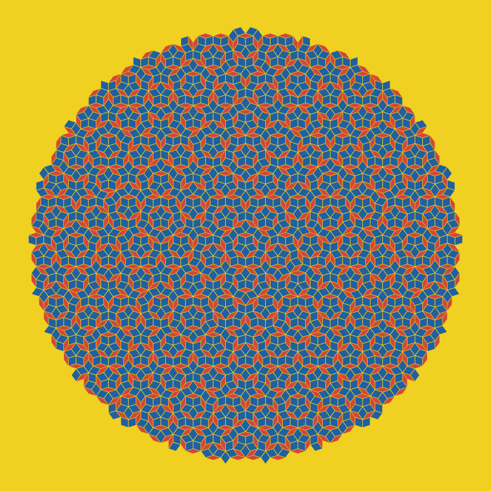
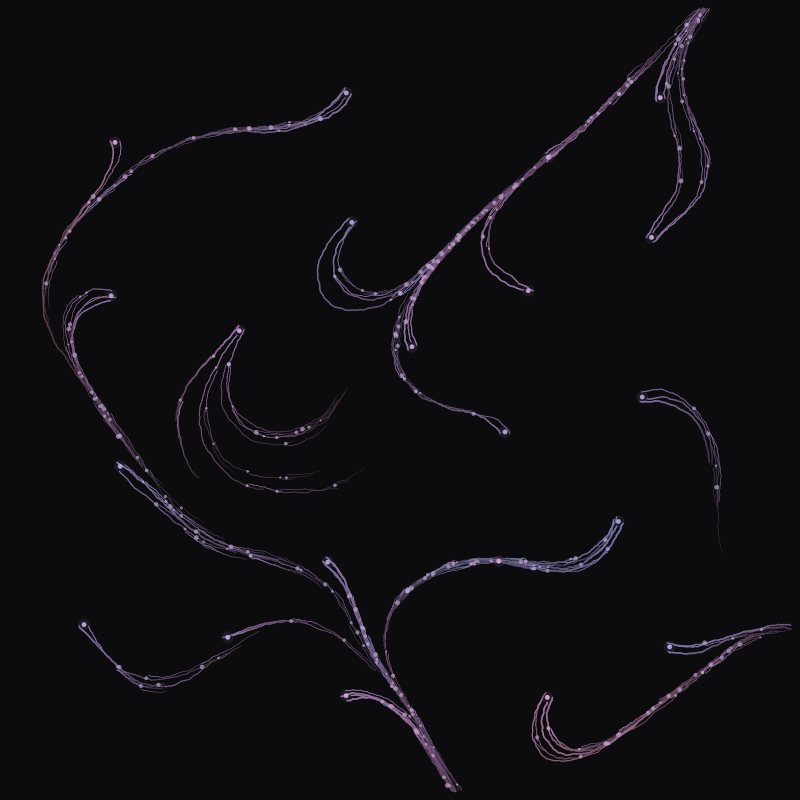

# genpuin

A generative art tool. Render a PNG, PPM, or SVG from a Lua script.
Also works as a plain Zig library.

<p>
  
  
</p>

The name is an acronym of "penguin" and an easy typo if you use the Colemak keyboard layout.

## Build

Requires Zig 0.17.

```
$ zig build --release=fast               # install to ./zig-out/bin
$ zig build --release=fast -p ~/.local   # install to ~/.local/bin
$ zig build test
$ zig build examples                     # generate examples to ./out
```

LuaJIT is embedded by default. Pick another Lua with `-Dlang=lua54` (or `lua51` to `lua55`).

## Usage

```
$ genpuin --help
$ genpuin art.lua                    # writes art.svg
$ genpuin art.lua -o art.png         # write a PNG
$ genpuin art.lua -o art.png -s 4    # 4x the pixels
$ genpuin art.lua -o art.png --ss 3  # supersample
$ genpuin art.lua --vary 1..16       # contact sheet of 16 variations
```

A script builds a canvas and returns it. The library is the global `gen`.

```lua
local c = gen.canvas(800, 800)
gen.background(c, gen.hex("#14121c"))

for i = 1, 200 do
    local p = gen.randInCircle({400, 400}, 300)
    gen.draw(c, gen.circle(p, gen.randRange(2, 30)), {
        fill = gen.hsv(0.05 + gen.perlin(p[1] * 0.01, p[2] * 0.01) * 0.1, 0.8, 1),
        opacity = 0.7,
    })
end

gen.post(c, "pixelSort", {direction = "y", lo = 0.2, hi = 1})
return c
```

Coordinates work like SVG: integers sit on pixel edges and y points down.

Output is deterministic and portable. For the same seed, a script will
produce equal output on any platform.

## API

The doc comments in `src/lua/prelude/` are the reference.

- **Canvas:** `canvas` `background` `draw` `style` `layer`
- **Shapes:** `line` `polyline` `polygon` `circle` `ellipse` `arc` `rect` `bezier` `spline` `compound` `bezierPoint` `bezierTangent` `splineToBeziers` `catmullRomToBezier`
- **Color:** `rgb` `rgba` `hsv` `hsl` `hex` `lerpColor` `darken` `lighten` `withAlpha`
- **Gradients:** `linearGradient` `radialGradient`
- **Pen:** `pen`
- **Transforms:** `translate` `rotate` `rotateAround` `scale` `scaleAround` `reflectX` `reflectY` `reflect`
- **Randomness:** `seed` `rand` `randRange` `randInt` `gaussian` `pick` `shuffle` `weightedPick` `randInCircle` `randOnCircle` `randInRect` `poissonDisk`
- **Noise:** `noiseSeed` `perlin` `fbm` `simplex` `valueNoise` `worley` `curl` `noiseGrid`
- **Flow:** `flowField` `noiseField` `trace` `curlFlow` `traceFlow`
- **Patterns:** `grid` `radial` `scatter` `spiral` `alongPath` `subdivideRect` `kaleidoscope` `GOLDEN_ANGLE`
- **Path effects:** `jitter` `smooth` `taper` `stipple` `dash` `sampleAlong` `subdivide` `resample`
- **Path ops:** `clip` `clipLines` `offset` `offsets` `simplify` `hatch` `contours` `toContours` `joinPaths` `orderPaths`
- **Signed distance:** `sdCircle` `sdBox` `sdSegment` `sdPolygon` `sdUnion` `sdSubtract` `sdIntersect` `sdSmoothUnion` `sdSmoothSubtract` `sdSmoothIntersect` `sdRound` `sdOnion` `sdRepeat` `sdTranslate` `sdRotate` `sdScale` `sdEval` `sdfField`
- **Voronoi:** `voronoi` `relax`
- **Spatial:** `pointInRect` `pointInCircle` `pointInPolygon` `nearest` `withinRadius` `packCircles` `separate`
- **L-systems:** `rewrite`
- **Cellular automata:** `elementary` `evolve` `life`
- **Markov chains:** `markov` `markovFrom` `markovStep` `markovGenerate`
- **Wave function collapse:** `wfc` `wfcOverlap` `wfcDraw`
- **Simulations:** `reactionDiffusion` `physarum` `dla` `differentialGrowth`
- **Fields and textures:** `field` `image` `splat` `blurField` `fieldGradient` `attractor` `flame` `randomFlame`
- **Post passes:** `post` with `invert` `pixelSort` `channelShift` `displace` `tear` `blockRepeat` `dither` `posterize` `blur` `bloom` `grain` `levels` `scanlines`
- **Vec2:** `vec2` `vec2Add` `vec2Sub` `vec2Scale` `vec2Len` `vec2FromAngle` `vec2Dot` `vec2Lerp` `vec2Rotate`
- **Utilities:** `lerp` `mapRange` `clamp` `dist` `angle` `norm` `degrees` `radians`
- **Export:** `exportSvg` `exportPng` `exportPpm`
